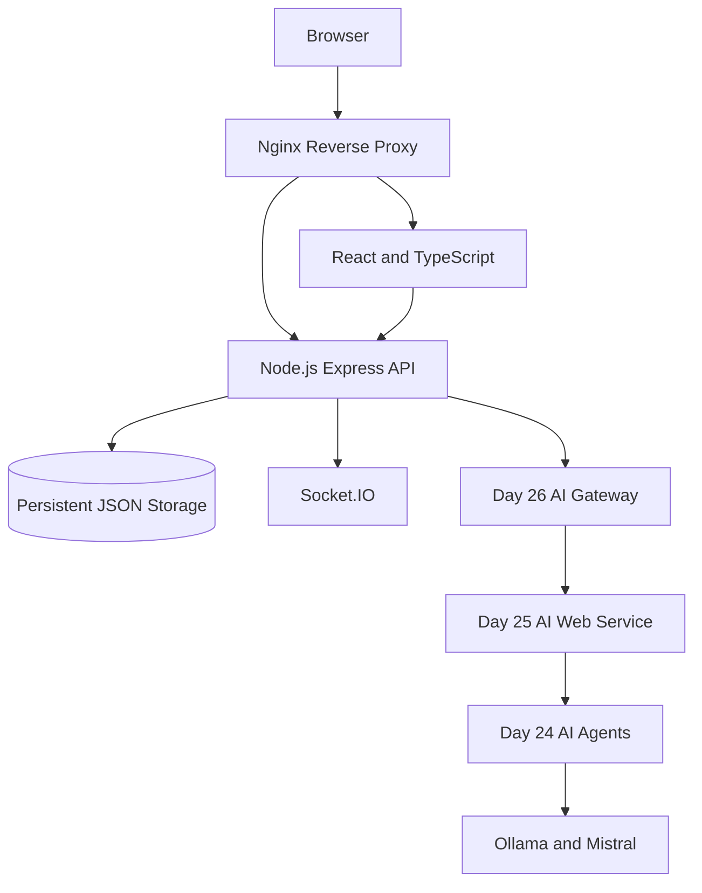

# SDA Training Capstone Project — Presentation Slides

**Project:** TaskPilot AI — AI-Powered Task Management Platform\
**Presenter:** [Your Name]\
**Date:** [Presentation Date]\
**Program:** SDA Training — 28-Day Program\

---

## Slide 1 — Title

# TaskPilot AI

### AI-Powered Task Management Platform

Full-Stack Development, AI Integration and DevOps\
SDA Training — Final Project Demonstration\
**Presenter:** [Your Name]

---

## Slide 2 — Project Overview

### Objective
Build a practical application that brings together modern software development technologies.

### Main Areas
- Full-stack web development.
- REST API and backend development.
- AI-powered application capabilities.
- Mobile development learning and integration.
- Docker and Kubernetes.
- CI/CD automation and testing.

---

## Slide 3 — Technology Stack

| Area | Technologies |
|---|---|
| Frontend | React, TypeScript, Vite |
| Backend | Node.js, Express |
| Authentication | JWT |
| Real-time | Socket.IO |
| Storage | JSON persistence, Docker named volume |
| AI | Ollama, Mistral, Python AI services |
| Reverse Proxy | Nginx |
| Containers | Docker, Docker Compose |
| Orchestration | Kubernetes, Kustomize |
| CI/CD | GitHub Actions |
| Mobile Learning | React Native, Flutter |

---

## Slide 4 — System Architecture

---

## Slide 5 — Task Management Features

- User registration and login.
- JWT-protected endpoints.
- Create, view, update and delete tasks.
- Task priority management.
- Pending, in-progress and completed statuses.
- User-specific task access.
- Persistent task storage.
- Real-time task events.

---

## Slide 6 — AI Integration

### Three Demonstrated Capabilities

#### 1. AI Chat
- Conversational AI.
- Persistent conversation thread identifiers.
- Local Mistral model integration.

#### 2. Content Generation
- Topic-based generation.
- Configurable content type.
- Tone, length and keyword options.

#### 3. Recommendations
- Profile-based recommendations.
- Catalogue tag matching.
- Ranked recommendation results.

---

## Slide 7 — Mobile Development

### React Native
- Cross-platform mobile development.
- Component-based application development.
- Mobile API integration.

### Flutter
- Cross-platform UI development.
- Dart programming.
- Widget-based application architecture.

### AI Mobile Integration
- Mobile-friendly AI gateway.
- Chat and generation endpoints.
- Recommendation and memory endpoints.

> **Note:** These are separate mobile training deliverables and AI integration components, not embedded TaskPilot mobile applications.

---

## Slide 8 — DevOps and Deployment

### Docker
- Frontend and backend images.
- Docker Compose orchestration.
- Health checks.
- Persistent named volume.

### Kubernetes
- Namespace configuration.
- Backend and frontend deployments.
- Kubernetes services.
- Persistent volume claim.
- Kustomize resource configuration.

### CI/CD
- GitHub Actions.
- Automated backend tests.
- Frontend TypeScript validation and build.
- AI regression tests.
- Docker and Kubernetes validation.

---

## Slide 9 — Verified Project Results

| Validation | Result |
|---|---|
| Backend regression tests | 12/12 passed |
| AI chat integration | Passed |
| Content generation | Passed |
| Recommendations | Passed |
| Docker task CRUD | Passed |
| Persistence after restart | Passed |
| Frontend production build | Passed |
| Kubernetes rendering | Passed |
| GitHub Actions required checks | Successful |

> *No unmeasured latency, throughput or uptime figures are claimed.*

---

## Slide 10 — Security

- JWT-based authentication.
- Protected application routes.
- User-level task ownership.
- Request validation.
- API rate limiting.
- Helmet security middleware.
- Environment-based secrets.
- Secret environment files excluded from Git.

---

## Slide 11 — Testing Strategy

### Backend
- Registration and login.
- Duplicate account validation.
- Task CRUD.
- User data isolation.
- AI route validation.
- Analytics.

### Integration
- Real AI gateway requests.
- Authenticated API requests.
- Socket.IO handshake.
- Docker networking.

### Deployment
- Docker health checks.
- Persistent volume verification.
- Kubernetes manifest rendering.
- GitHub Actions CI/CD validation.

---

## Slide 12 — Learning Outcomes

### Week 1 — Foundations
- SDLC and Git.
- HTML, CSS and JavaScript.
- React and API integration.

### Week 2 — Backend
- Node.js and Express.
- API design.
- Database concepts and persistence.

### Week 3 — DevOps and Mobile
- Docker and Compose.
- Kubernetes.
- CI/CD.
- React Native and Flutter.

### Week 4 — AI and Capstone
- AI/ML fundamentals.
- LLMs and generative AI.
- AI agents.
- Web and mobile AI integration.
- Full-stack capstone.

---

## Slide 13 — Challenges and Solutions

| Challenge | Approach |
|---|---|
| Service-to-service networking | Docker host gateway configuration |
| API request validation | Joi schemas and controlled payloads |
| Frontend/backend status differences | Explicit status mapping |
| Persistent application state | Docker named volume |
| Environment configuration | Separate example and secret files |
| Integration reliability | Automated and live endpoint tests |

---

## Slide 14 — Future Enhancements

- Replace demonstration JSON storage with a production database.
- Improve AI response quality and output validation.
- Expand recommendation personalization.
- Integrate mobile interfaces more deeply.
- Add production monitoring and observability.
- Deploy to a managed cloud Kubernetes environment.
- Improve automated end-to-end testing.

---

## Slide 15 — Conclusion

### What This Project Demonstrates
- Full-stack application development.
- Backend API and authentication implementation.
- Local AI service integration.
- Mobile development learning.
- Docker and Kubernetes configuration.
- Automated testing and CI/CD.

### Thank You

**Questions and Discussion**

- **Repository:** [https://github.com/soumik3312/Mechlin-SDA-Training](https://github.com/soumik3312/Mechlin-SDA-Training)
- **Local demonstration:** [http://localhost:8080](http://localhost:8080)